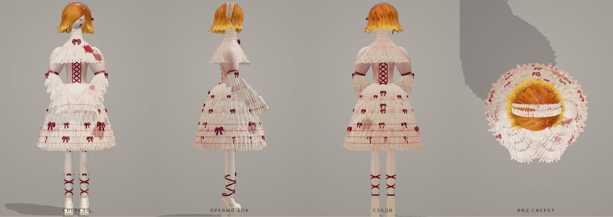
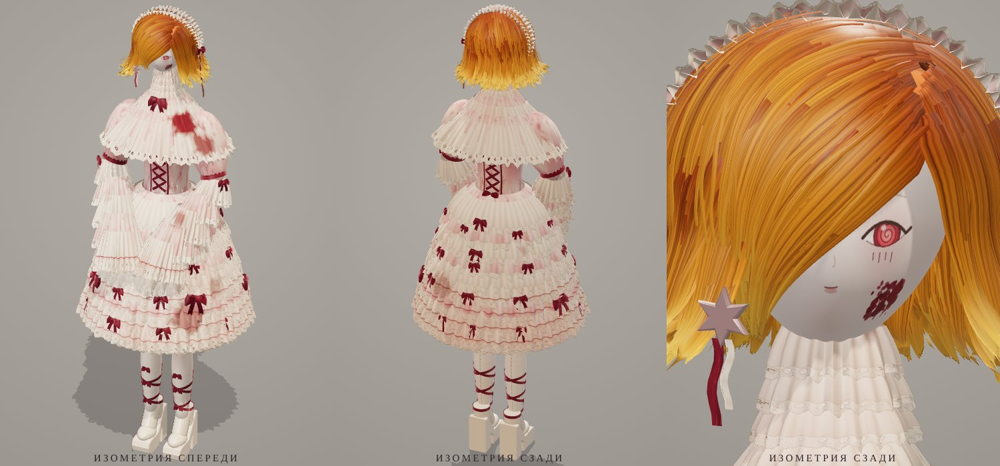

# Кукла в рюшах — 3D-модель

Процедурная модель куклы по листам разворота (спереди, бока, сзади, сверху, портрет).

- `doll.glb` — готовая модель (glTF binary, ~8 МБ): открывается в Blender, Windows 3D Viewer, https://gltf-viewer.donmccurdy.com и т. п.
- `doll.js` — генератор модели на Three.js: вся геометрия и текстуры строятся кодом.
- `index.html` — просмотрщик с ракурсами как на листе. Запуск: `npx serve models/doll` и открыть в браузере.

Масштаб: 1 единица = 1 м, рост 1,62 м, кукла смотрит в +Z.
Части модели разнесены по группам: Skirt, Petticoat, Bodice, Collar, Cape, Sleeves, Hands, Legs, Shoes, Head, Hair, Bonnet, Bows, Lacing, Earring.

