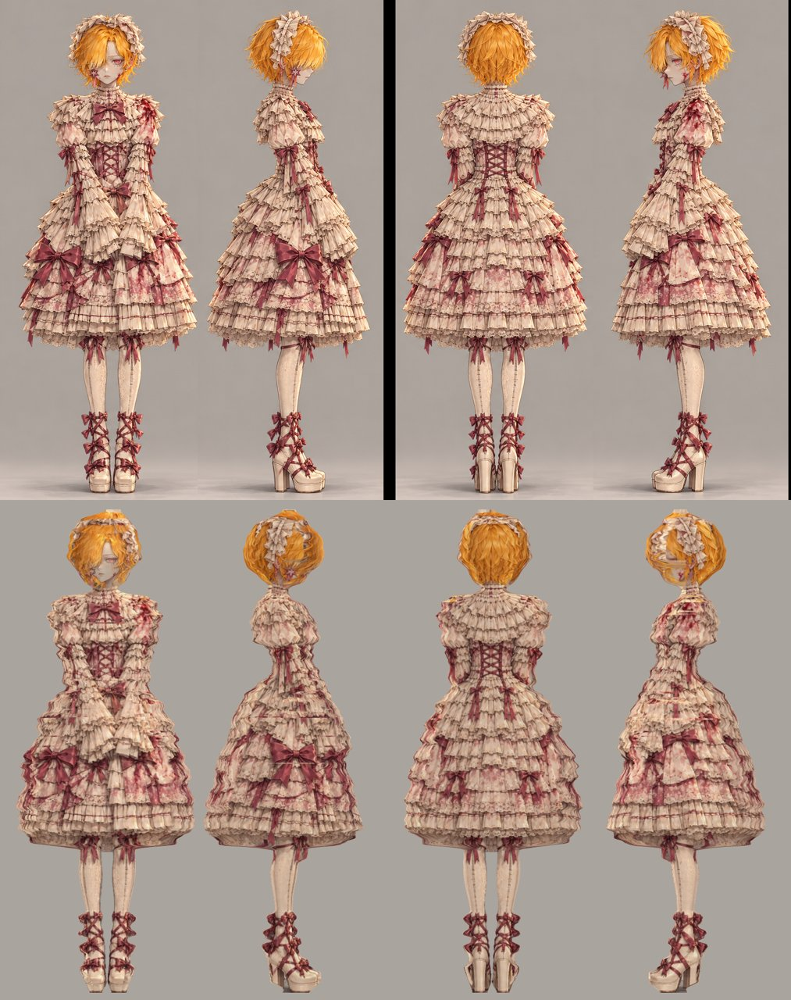
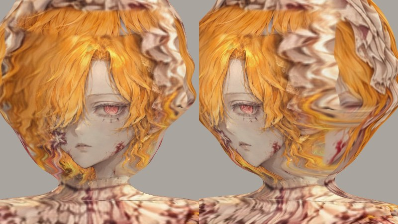

# Кукла в рюшах — 3D-модель

Реконструкция по исходным изображениям: лист разворота (спереди, правый бок, сзади, левый бок), вид сверху и портрет.
Форма вырезана по силуэтам видов, текстура спроецирована прямо с рисунков, поэтому банты, принт, кружево и пятна стоят там же, где на листе.

- `doll.glb` — модель (glTF binary, 9,5 МБ, 187 тыс. вершин, одна текстура 4096×4096). Открывается в Blender, «Средстве 3D-просмотра» Windows, https://gltf-viewer.donmccurdy.com.
- `index.html` — просмотрщик с ракурсами как на листе. Запуск: `npx serve models/doll`.
- `print/doll_print.stl` — модель для 3D-печати с настоящим рельефом (ярусы, банты, руки, лицо, пряди); подробности в `print/README.md`.
- `reconstruction/` — пайплайн и исходники. Пересборка: `cd reconstruction && python3 build.py` (numpy, scipy, opencv-python-headless, pillow, trimesh).

Масштаб: 1 единица = 1 м, рост 1,62 м, кукла смотрит в +Z.

## Как собрано
1. Кукла вырезается из фона на каждом виде (подгонка фона полиномом + GrabCut).
2. По каждой строке листа берутся границы силуэта во всех четырёх видах; сечение тела — суперэллипс с отдельными полуосями для каждого квадранта. Ноги и туфли — отдельные тела.
3. Камера вида сверху подобрана по совпадению силуэта и положению головы: она наклонена на ≈10° к лицу.
4. Текстура запекается проекцией со всех видов с весом по нормали; каждый вид построчно подгоняется под общий силуэт. Лицо и волосы спереди взяты с портрета (подгонка по глазу, рту, подбородку и серьге, выравнивание цвета под лист).
5. Рельеф рюш — небольшое смещение по яркости текстуры.

## Ограничения
С четырёх основных ракурсов модель почти совпадает с листом. Между ними и сверху это форма по силуэтам: банты и кружево нарисованы на поверхности, а не вылеплены отдельной геометрией, и на висках головы текстура тянется. Причина в том, что боковые рисунки изображают лицо иначе, чем фронтальный.

