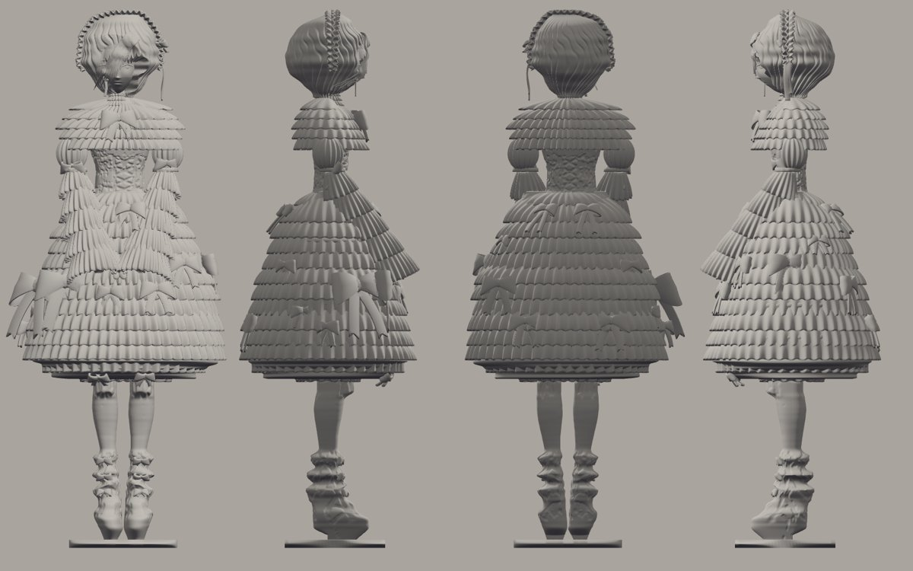
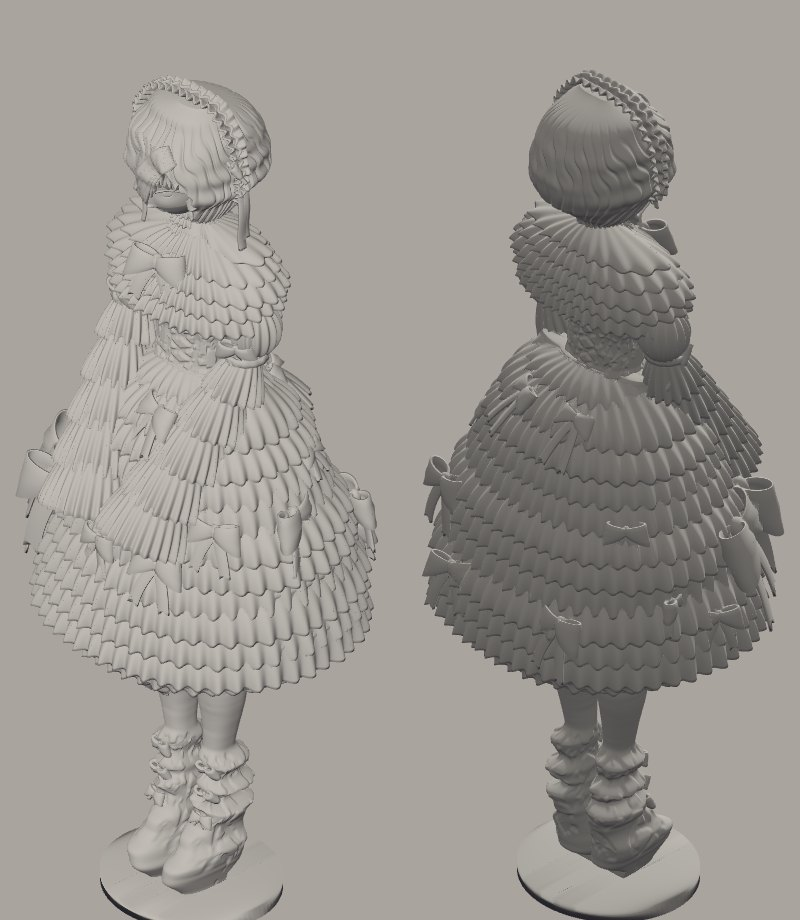
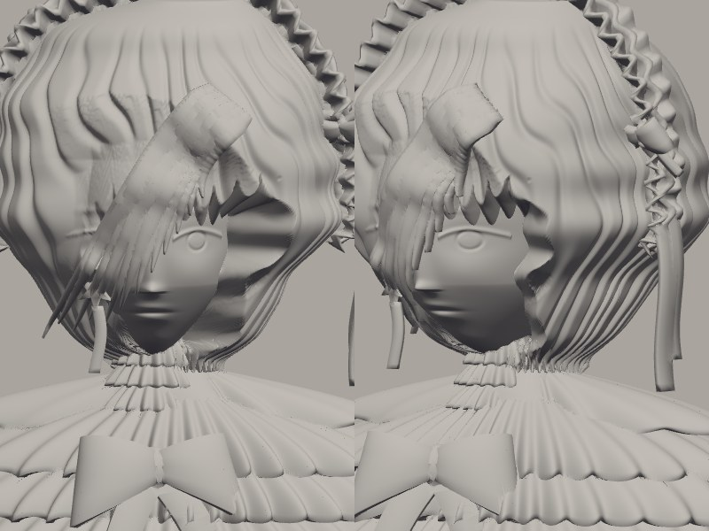

# Кукла в рюшах — модель для 3D-печати

`doll_print.stl` — цельная водонепроницаемая сетка (1,14 млн треугольников, проверена как замкнутое тело), единицы — миллиметры.

- **Масштаб 1:10**: рост с подставкой 165 мм, габарит 68 × 165 × 56 мм, объём 114 см³ (сплошной).
- Вся детализация — геометрия, а не текстура: 13 ярусов юбки и 5 ярусов пелерины со складками и свесом, плиссированный воротник,
  буфы и рукава-колокола из пяти ярусов, сложенные кисти, 28 объёмных бантов с хвостами на тех же местах, что на рисунках,
  выпуклая шнуровка корсета и ленты на щиколотках, лицо (глазные впадины, веко, радужка видимого глаза, нос, губы, подбородок),
  волосы прядями и косая чёлка, капор с тремя рядами оборок и лентами, звезда-серьга, подставка.

## Как печатать
- **Фотополимер (рекомендую)**: печатать как есть, 1:10. Тонкие элементы — оборки капора, хвосты лент, пряди чёлки — около 0,45–0,5 мм; фотополимер их держит.
  В слайсере (Chitubox, Lychee) сделай полость со стенкой 1,5–2 мм и дренажные отверстия в подставке — так уйдёт примерно втрое меньше смолы.
- **FDM (сопло 0,4)**: увеличь модель минимум до 200 % (рост 33 см), иначе мелкие оборки и ленты не пропечатаются. Слой 0,08–0,12 мм.
- **Поддержки нужны**: нижние кромки ярусов юбки, пелерины и рукавов — нависания. Ставь древовидные поддержки только снаружи от модели,
  с наклоном модели 10–15° назад, чтобы лицо и банты спереди остались без следов.

## Пересборка
`cd ../reconstruction && python3 build.py && python3 print_model.py` (numpy, scipy, opencv-python-headless, pillow, trimesh, manifold3d, rtree, fast-simplification).
Силуэты берутся из реконструкции по листу разворота, детали строятся как замкнутые тела и объединяются булевыми операциями.
Положения бантов заданы списком `BOWS` в `print_model.py` (ракурс, координаты на листе, размер) и ставятся на поверхность трассировкой луча.

